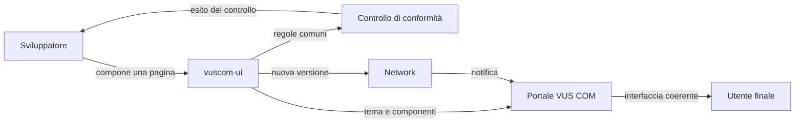

## In una frase

vuscom-ui dà ai portali VUS COM componenti grafici e regole comuni, così risultano coerenti e riconoscibili.

## Il problema che risolve

Ogni portale aveva il rischio di scegliere colori, menu e controlli diversi.
Questo rendeva più difficile imparare a usare un nuovo portale.
Creava anche lavoro ripetuto per chi sviluppa le applicazioni.

vuscom-ui raccoglie gli elementi grafici già pronti e le regole per usarli.
Un portale nuovo parte quindi con la struttura VUS COM.
Il pacchetto controlla anche che i portali rispettino lo standard concordato.

## Un esempio concreto

Luca deve creare una nuova pagina per gli operatori.
Usa vuscom-ui per il menu, il titolo, i pulsanti e la tabella.
La pagina eredita il tema chiaro e scuro previsto.
Usa anche icone e colori coerenti con gli altri portali.

Luca aggiunge il pulsante «Segnala un problema» senza ricostruirlo.
Prima della consegna, esegue il controllo di conformità.
Il controllo segnala un eventuale elemento obbligatorio mancante.
Chi usa il nuovo portale ritrova quindi gesti e schermate già conosciuti.

## Chi lo usa

- **Sviluppatori dei portali**: inseriscono i componenti nelle applicazioni VUS COM.
- **Utenti finali**: vedono interfacce coerenti, ma non usano vuscom-ui direttamente.
- **IT VUS COM**: mantiene lo standard e verifica gli aggiornamenti.

## Come funziona, passo per passo

1. **Il portale sceglie una versione pubblicata.** La versione resta fissa fino a un aggiornamento deciso dal portale.
2. **Il portale importa tema e componenti.** Può usare pulsanti, campi, tabelle, finestre e avvisi già pronti.
3. **Il portale compone la pagina.** Usa una struttura comune per menu laterale, intestazione e contenuto.
4. **Il pacchetto applica identità visiva e accessibilità.** Include modalità chiara e scura, testi italiani e controlli adatti alla tastiera.
5. **Il portale aggiunge moduli facoltativi.** Sono disponibili gestione utenti, grafici e segnalazione dei problemi.
6. **Il controllo di conformità esamina il portale.** Confronta il risultato con regole mantenute insieme al pacchetto.
7. **Una nuova versione viene notificata ai portali interessati.** Ogni portale decide quando adottarla e conferma l'aggiornamento.

## Cosa deve fare

- **R1. Fornisce un tema comune per tutti i portali.** Si verifica: due portali che usano la stessa versione mostrano gli stessi colori semantici.
- **R2. Offre componenti riutilizzabili per le azioni comuni.** Si verifica: una pagina usa pulsante, campo e tabella senza ricrearli localmente.
- **R3. Mantiene una struttura comune delle pagine interne.** Si verifica: il menu laterale, il titolo e il contenuto seguono lo stesso schema.
- **R4. Supporta l'uso con tastiera e tecnologie assistive.** Si verifica: un controllo si raggiunge con Tab e comunica il proprio scopo.
- **R5. Include il pulsante «Segnala un problema» riutilizzabile.** Si verifica: un portale abilitato invia una segnalazione al proprio servizio.
- **R6. Verifica automaticamente le regole comuni dei portali.** Si verifica: un portale senza guida riceve un esito di blocco.
- **R7. Mantiene ogni versione immutabile dopo la pubblicazione.** Si verifica: un portale resta identico finché non sceglie una versione successiva.
- **R8. Notifica gli aggiornamenti ai portali registrati.** Si verifica: dopo una pubblicazione, ogni portale interessato riceve una richiesta separata.

## A che punto è

vuscom-ui è in produzione con la versione 1.29.0.
Il 19/11/2026 è usato da Hub Offerte, Cruscotto, Portale Segnalazioni, Configuratore e OutBound.
BrainEditor, DB VUS COM, CallManager e Vicky lo usano senza ricevere ancora le notifiche di aggiornamento.

## Cosa manca

- Migrazione a Tailwind 4 e alla libreria di unione delle classi (#12, sblocca IT VUS COM).
- Confronto visivo automatico del catalogo prima di ogni pubblicazione (#11, sblocca IT VUS COM).
- Aggiornamento automatico condiviso dopo una pubblicazione (#7, sblocca IT VUS COM).
- Colore dedicato per PortaleDistributori (#6, sblocca IT VUS COM).
- Gestione temporanea della barra laterale compatta (#2, sblocca IT VUS COM).
- Registrazione dei portali già utilizzatori nel sistema di notifica (sblocca IT VUS COM).

## Con chi lavora

- **Hub Offerte**: riceve tema, componenti e struttura delle pagine.
- **Cruscotto**: riceve componenti per tabelle, filtri e grafici.
- **Portale Segnalazioni**: riceve il tema e integra la segnalazione dei problemi.
- **Configuratore**: riceve tema, componenti e struttura delle pagine.
- **OutBound**: riceve tema, componenti e struttura delle pagine.
- **BrainEditor, DB VUS COM, CallManager e Vicky**: usano il pacchetto, ma non sono ancora registrati per le notifiche.
- **Network**: consegna le richieste di aggiornamento ai portali registrati.

## Parole da sapere

- **Accessibilità**: qualità che permette di usare l'interfaccia anche con tastiera o tecnologie assistive.
- **API**: punto di dialogo fra programmi.
- **Build**: preparazione dei file pronti per essere distribuiti ai portali.
- **Catalogo**: pagina che mostra i componenti disponibili e il loro comportamento.
- **Componente**: elemento grafico riutilizzabile, come un pulsante o una tabella.
- **Controllo di conformità**: verifica automatica del rispetto delle regole comuni.
- **esbuild**: strumento che prepara la libreria per la distribuzione.
- **IT VUS COM**: gruppo che gestisce gli strumenti informatici aziendali.
- **JavaScript**: linguaggio usato per creare comportamenti nelle pagine web.
- **Libreria**: raccolta di funzioni e componenti che altri progetti possono riusare.
- **Network**: sistema interno che inoltra richieste di aggiornamento tra progetti.
- **npm**: strumento che distribuisce e installa librerie JavaScript.
- **Pubblicazione**: disponibilità di una nuova versione del pacchetto per gli altri portali.
- **React**: libreria JavaScript usata per costruire interfacce web.
- **Tailwind**: strumento che applica l'aspetto grafico attraverso classi riutilizzabili.
- **Tag**: etichetta permanente che identifica una precisa versione pubblicata.
- **Tecnologie assistive**: strumenti, come i lettori di schermo, che aiutano a usare un sito.
- **Tema**: insieme di colori, spaziature e regole visive comuni.
- **Testing Library**: strumento che controlla l'interfaccia dal punto di vista dell'utente.
- **Tab**: tasto che sposta il cursore al controllo successivo.
- **Versione**: stato identificato e stabile del pacchetto pubblicato.
- **Vitest**: strumento che esegue verifiche automatiche del codice.
- **VUS COM**: organizzazione che usa e mantiene questi portali.

## Dettaglio tecnico

- La libreria usa React 18 e Tailwind 3.
- La preparazione della libreria usa esbuild.
- Le verifiche automatiche usano Vitest e Testing Library.
- Testing Library controlla il comportamento dell'interfaccia dal punto di vista dell'utente.
- Il pacchetto non possiede un database né espone un'API propria.
- Alcuni moduli richiedono servizi offerti dal portale che li integra.
- L'architettura separa tema, componenti semplici, componenti composti e strutture di pagina.
- I moduli per utenti e segnalazioni sono entrate separate della libreria.
- Il rilascio prepara la libreria, esegue le verifiche e pubblica una versione etichettata.
- Dopo la pubblicazione, Network avvisa separatamente i portali interessati.
- La libreria conserva anche il risultato preparato, per renderlo disponibile senza nuove preparazioni.
